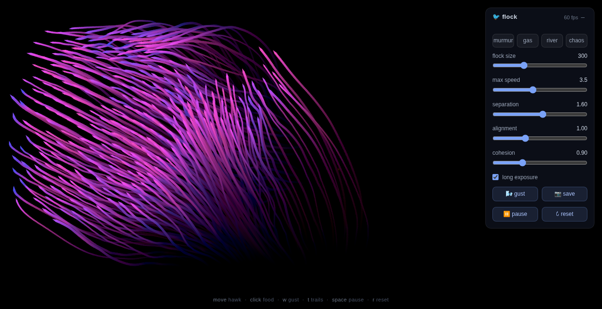

# 🐦 flock

**[▶ Live demo](https://vesanieminen.github.io/flock/)** — no install, just open and play.

A starling murmuration that runs itself — hundreds of boids following three
simple local rules, no choreography, emergent everything. One self-contained
HTML file, zero dependencies, no build step.



## Run it

```bash
open index.html          # macOS
xdg-open index.html      # Linux
```

Or just drag the file into any browser.

## Interactions

| Input | Effect |
|---|---|
| **Move mouse** | You're a hawk — the flock scatters from the cursor |
| **Click** | Drops food; the flock converges on a pulsing glow for 4 s |
| **`w`** | Wind gust in a random direction, with animated streaks |
| **`t`** | Long-exposure trails — the flow field paints itself |
| **`space`** | Pause |
| **`r`** | Reset |

## Presets

One click, four personalities: **murmur** (classic starlings), **gas**
(explosive repulsion), **river** (parallel high-speed streams), **chaos**
(strong cohesion, no alignment).

## Console playground

Open devtools and poke the live simulation:

```js
flock.params.maxSpeed = 6
flock.triggerGust(0)          // gust due east
flock.applyPreset('chaos')
```

## How it works

- Each boid steers by **separation, alignment, and cohesion** over its local
  neighborhood — global flocking emerges from purely local rules
- Neighbor lookups use a **spatial hash** (cell size = perception radius),
  keeping the update ~O(n) so 900 boids hold 60 fps
- Rendering is plain canvas 2D: velocity-aligned triangles, hue shifting
  blue → pink with speed, motion trails via a translucent background wash
- Everything (physics, UI, rendering) lives in one ~500-line file

## Save a frame

The 📷 button exports the current canvas as a timestamped PNG — long-exposure
mode makes surprisingly good generative art.
